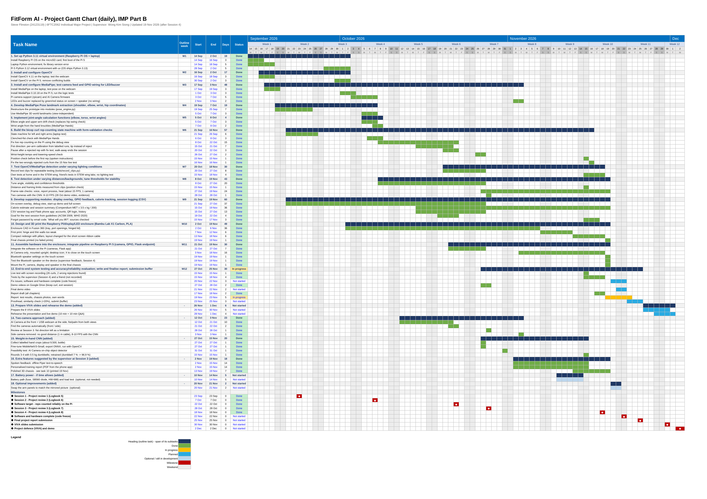

# FitForm AI - Project documents

| Folder | What is in it |
|---|---|
| [gantt/](gantt/) | Project Gantt chart (daily), updated after each supervisor meeting |
| [figures/](figures/) | Hardware block diagram and other figures |
| [website/](website/) | Screenshots of the FitForm phone web app and an example PDF report |
| [photos/](photos/) | Photos of the parts and the build progress |

Videos: see [VIDEOS.md](../VIDEOS.md)

## Final tests (22-23 Nov 2026)

The rep counting was improved on 22 Nov and compared with the version of 19 Nov (GitHub commit 9af7324) by replaying
the same labelled AI Camera clips through both, frame by frame at 15 FPS:

| Clip (what was done) | Correct result | 19 Nov version | Final version |
|---|---|---|---|
| Slow proper curls, both arms | all counted | 11 of 12 counted | 12 of 12 counted |
| Proper curls, hand to the front of the body (2 clips) | all counted | 9 of 10 counted | 10 of 10 counted |
| Fast drops after a normal lift (2 clips) | all rejected | 13 of 13 rejected | 13 of 13 rejected |
| Fast swings | all rejected | 14 of 14 rejected | 14 of 14 rejected |

What changed: the lowering is timed correctly when the forearm points at the camera (good curls were called
"lowered too fast"), and the upper-arm checks also run at the top and while lowering (in a live test the 19 Nov
version counted 7 curls with the elbows flared out; the final version rejected 4 of 4). Live sessions were recorded
with timestamped logs, a screenshot every 2 s and the Pi's temperature. Limits found: a bent wrist cannot be judged
with one front camera, loose clothing makes the upper-arm checks more lenient, and the Pi reached 84-87 deg C
without a cooler. Details: README, "Known limitations".

Also added after these tests: Follow my goal (sets with a 60 s rest) or Challenge yourself; the voice names the
arm, joins both arms' sentences and plays a chime so a Bluetooth speaker does not cut the first word; Cancel and
Delete my account on the phone; Forget speaker on the touch screen.

## Latest Gantt chart (19 Nov 2026, after Session 4)

Status up to 19 Nov and the plan to the report (25 Nov) and the VIVA (2 Dec 2026). The Excel file also has an
"Outline vs Actual" sheet comparing it with the Project Outline plan and explaining each change.

- Excel: [FitForm_AI_Gantt_Chart_Daily_v8.xlsx](gantt/FitForm_AI_Gantt_Chart_Daily_v8.xlsx)
- PDF: [FitForm_AI_Gantt_Chart_Daily_v8.pdf](gantt/FitForm_AI_Gantt_Chart_Daily_v8.pdf)
- Previous version (31 Oct, after Session 3): [v7 Excel](gantt/FitForm_AI_Gantt_Chart_Daily_v7.xlsx), [v7 PDF](gantt/FitForm_AI_Gantt_Chart_Daily_v7.pdf)

## Finished device (19 Nov 2026)

The final chassis printed on the Bambu Lab X1 Carbon with all parts mounted: the Raspberry Pi AI Camera at the
top, the 7-inch touch display (DSI ribbon cable) in the front frame and a carry handle. The main body took
13 h 40 min to print with supports (about 392 g of PLA). The Bluetooth speaker stays outside the chassis.

## Why the side camera was removed

Frame from the demo video recorded on 28 Oct with two cameras and the weight-in-hand CNN, viewed through Raspberry
Pi Connect: the program ran at 8-10 FPS (about 15 FPS with one camera), and the side view (bottom right) did not
detect the left hand - here the left hand holds a bottle but the screen asks to clench the fist. With its 1 m
cable the webcam could not be placed at a good distance for a side view.

## FitForm phone web app (screenshots)

The web app runs on the Raspberry Pi itself (Flask, port 5000) and can only be opened from a phone on the same
Wi-Fi or hotspot as the device, so these screenshots show what it looks like. They were taken from the code in
this repository with a demo account and five demo sessions (not real training data).

| Screen | What it shows |
|---|---|
| [Login](website/1_login.png) | Log in or create an account (username, password, email for password reset, body weight) |
| [Dashboard](website/2_dashboard_next_goal.png) | "Train on this device" button and the goal for the next session with tips |
| [Week, calories, last session](website/3_week_calories_last_session.png) | Sessions this week, calories per session against the goal, details of the last session and why curls were not counted |
| [History and PDF report](website/4_history_and_pdf_report.png) | All sessions, CSV download, and the personalised PDF report for any dates |
| [PDF report page 1](website/5_pdf_report_page1.png), [page 2](website/5_pdf_report_page2.png) | Example personalised training report |

## Hardware block diagram (final, 19 Nov 2026)

One camera (Raspberry Pi AI Camera, front). The side webcam was tried and removed (1 m cable, no 90 degree
view, extra processing load), and the planned LEDs and buzzer were replaced by the green/red form status on the
touch display and spoken feedback through a Bluetooth speaker (paired from the touch screen).

## Weight-in-hand CNN results (15 Nov 2026)

## Photos of the parts (31 Oct 2026, before the build)

