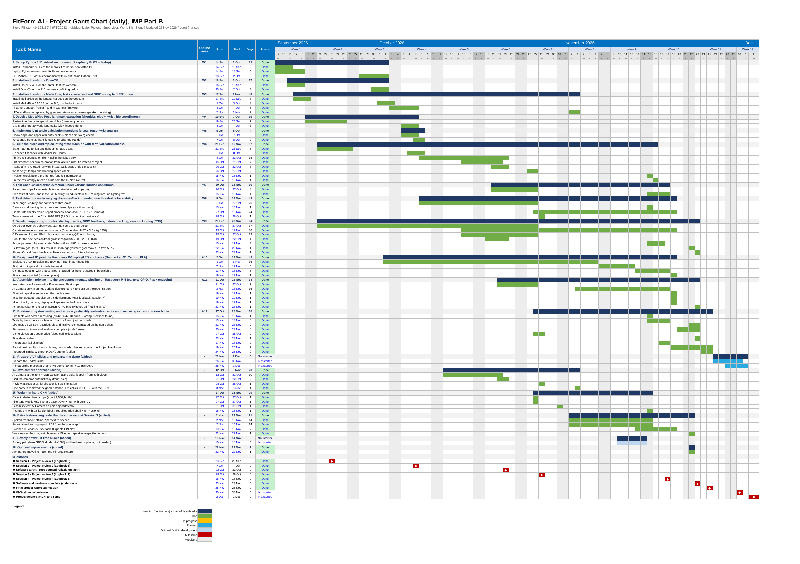
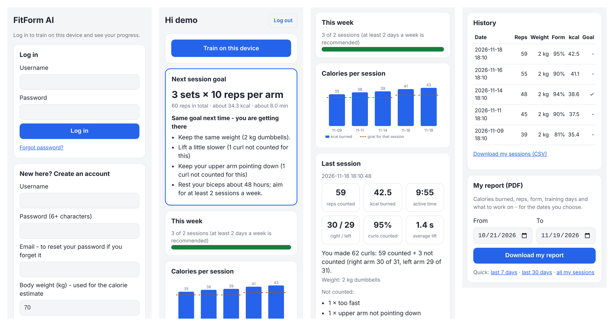

# FitForm AI - Project documents

| Folder | What is in it |
|---|---|
| [gantt/](gantt/) | Project Gantt chart (daily), updated after each supervisor meeting |
| [figures/](figures/) | Hardware block diagram and other figures |
| [website/](website/) | Screenshots of the FitForm phone web app and an example PDF report |
| [photos/](photos/) | Photos of the parts and the build progress |

Videos: see [VIDEOS.md](../VIDEOS.md)

## Final tests (22-23 Nov 2026)

The rep counting was improved on 22 Nov and compared with the version of 19 Nov (GitHub commit 9af7324) by replaying
the same labelled AI Camera clips through both, frame by frame at 15 FPS:

| Clip (what was done) | Correct result | 19 Nov version | Final version |
|---|---|---|---|
| Slow proper curls, both arms | all counted | 11 of 12 counted | 12 of 12 counted |
| Proper curls, hand to the front of the body (2 clips) | all counted | 9 of 10 counted | 10 of 10 counted |
| Fast drops after a normal lift (2 clips) | all rejected | 13 of 13 rejected | 13 of 13 rejected |
| Fast swings | all rejected | 14 of 14 rejected | 14 of 14 rejected |

What changed: the lowering is timed correctly when the forearm points at the camera (good curls were called
"lowered too fast"), and the upper-arm checks also run at the top and while lowering (in a live test the 19 Nov
version counted 7 curls with the elbows flared out; the final version rejected 4 of 4). Live sessions were recorded
with timestamped logs, a screenshot every 2 s and the Pi's temperature. Limits found: a bent wrist cannot be judged
with one front camera, loose clothing makes the upper-arm checks more lenient, and the Pi reached 84-87 deg C
without a cooler. Details: README, "Known limitations".

### Live accuracy tests with the final version (one person, 0.5 kg dumbbells, AI Camera)

Whether each curl was right or wrong is known from the person doing it (curls done wrong on purpose). The share
FitForm shows on the phone ("curls counted") is the user's own result; the columns below are FitForm's accuracy.

| Session | Curls made | Correct curls counted | Wrong curls rejected | Correct curls wrongly rejected |
|---|---|---|---|---|
| 23 Nov, only correct curls (20 per arm) | 40 | 40 of 40 | - | 0 |
| 23 Nov, only wrong curls | 21 | - | 21 of 21 | - |
| 22 Nov, mixed (Follow my goal, 3 sets of 10) | 68: 63 correct, 5 wrong | 60 of 63 | 5 of 5 | 3 |

- The wrong curls were dropping the weight (lowered in 0.36 s), lifting too fast (0.23-0.35 s) and the upper arm
  or elbow moving (out to the side or forward). **Fist and wrist faults were not included**: they are a known
  limitation of one front camera (the hand checks are advice only, and a bent wrist is caught only when large).
- The 3 correct curls wrongly rejected on 22 Nov were lowered in 0.48-0.49 s, one frame (about 0.07 s at 14 FPS)
  under the 0.50 s limit. In the 23 Nov correct session the fastest lowering was 0.61 s, and real drops are
  0.2-0.4 s, so only quick controlled lowerings near 0.5 s are affected.
- Earlier, 15 Nov (version of that day, USB webcam as the front camera): in the screen-recorded sessions at 23:42 (0.5 kg dumbbells) and 23:47 (no
  weight), 29 of 31 correct curls were counted; the 2 wrong rejections ('wrist bent' while fully curled, and 'too fast'
  with a 0.40 s lift on a 0.40 s limit) were rules that were too strict, fixed on 16 Nov. In the recorded session in
  between (23:45, 9 curls all wrong on purpose) the 3 arm faults were rejected, but the 6 curls with the fist turned
  upward were counted, because fist direction gives advice only (a known limitation). A dumbbell session that day at 20:43 (26 curls, 24 counted,
  both rejections 'lowered too fast' on the right arm) showed the first weight model marking all 26 curls 'no weight'.
- The supervisor (18 Nov) and a friend also tried FitForm; their sessions were not recorded.

The logs, screenshots and Pi temperatures of these sessions stay on the device (they belong to a user account).

Also added after these tests: Follow my goal (sets with a 60 s rest) or Challenge yourself; the voice names the
arm, joins both arms' sentences and plays a chime so a Bluetooth speaker does not cut the first word; Cancel and
Delete my account on the phone; Forget speaker on the touch screen.

## Latest Gantt chart (25 Nov 2026, report finalised)

Final status at the report submission (25 Nov) and the plan to the VIVA (2 Dec 2026). This is Figure A-1 in the
Final Report. The Excel file also has an "Outline vs Actual" sheet comparing it with the Project Outline plan and
explaining each change.

- Excel: [FitForm_AI_Gantt_Chart_Daily_v10.xlsx](gantt/FitForm_AI_Gantt_Chart_Daily_v10.xlsx)
- PDF: [FitForm_AI_Gantt_Chart_Daily_v10.pdf](gantt/FitForm_AI_Gantt_Chart_Daily_v10.pdf)
- Previous versions: 19 Nov, after Session 4 ([v8 Excel](gantt/FitForm_AI_Gantt_Chart_Daily_v8.xlsx), [v8 PDF](gantt/FitForm_AI_Gantt_Chart_Daily_v8.pdf));
  31 Oct, after Session 3 ([v7 Excel](gantt/FitForm_AI_Gantt_Chart_Daily_v7.xlsx), [v7 PDF](gantt/FitForm_AI_Gantt_Chart_Daily_v7.pdf))

## Finished device (19 Nov 2026)

The final chassis printed on the Bambu Lab X1 Carbon with all parts mounted: the Raspberry Pi AI Camera at the
top, the 7-inch touch display (DSI ribbon cable) in the front frame and a carry handle. The main body took
13 h 40 min to print with supports (about 392 g of PLA). The Bluetooth speaker stays outside the chassis.

## Why the side camera was removed

Frame from the demo video recorded on 28 Oct with two cameras and the weight-in-hand CNN, viewed through Raspberry
Pi Connect: the program ran at 8-10 FPS (about 15 FPS with one camera), and the side view (bottom right) did not
detect the left hand - here the left hand holds a bottle but the screen asks to clench the fist. With its 1 m
cable the webcam could not be placed at a good distance for a side view.

## FitForm phone web app (screenshots)

The web app runs on the Raspberry Pi itself (Flask, port 5000) and can only be opened from a phone on the same
Wi-Fi or hotspot as the device, so these screenshots show what it looks like. They were taken from the code in
this repository with a demo account and five demo sessions (not real training data).

| Screen | What it shows |
|---|---|
| [Login](website/1_login.png) | Log in or create an account (username, password, email for password reset, body weight) |
| [Dashboard](website/2_dashboard_next_goal.png) | "Train on this device" button and the goal for the next session with tips |
| [Week, calories, last session](website/3_week_calories_last_session.png) | Sessions this week, calories per session against the goal, details of the last session and why curls were not counted |
| [History and PDF report](website/4_history_and_pdf_report.png) | All sessions, CSV download, and the personalised PDF report for any dates |
| [PDF report page 1](website/5_pdf_report_page1.png), [page 2](website/5_pdf_report_page2.png) | Example personalised training report |

## Hardware block diagram (final, 19 Nov 2026)

One camera (Raspberry Pi AI Camera, front). The side webcam was tried and removed (1 m cable, no 90 degree
view, extra processing load), and the planned LEDs and buzzer were replaced by the green/red form status on the
touch display and spoken feedback through a Bluetooth speaker (paired from the touch screen).

## Weight-in-hand CNN results (15 Nov 2026)

## Photos of the parts (31 Oct 2026, before the build)

