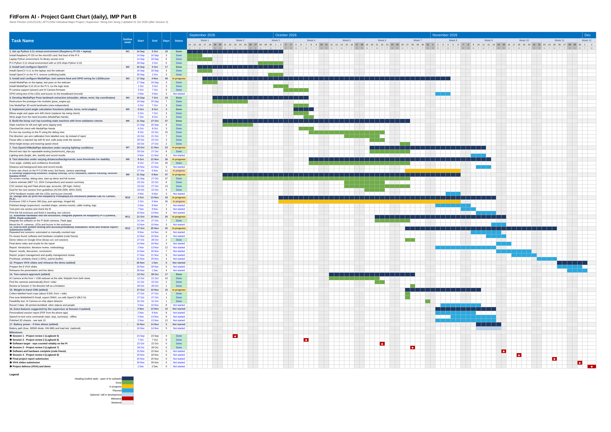

# FitForm AI - Project documents

| Folder | What is in it |
|---|---|
| [gantt/](gantt/) | Project Gantt chart (daily), updated after each supervisor meeting |
| [figures/](figures/) | Hardware block diagram and other figures (wiring diagram to follow) |
| [photos/](photos/) | Photos of the parts and the build progress |

Videos: see [VIDEOS.md](../VIDEOS.md)

## Latest Gantt chart (31 Oct 2026, after Session 3)

Status up to 31 Oct and the plan to the VIVA on 2 Dec 2026. The Excel file also has an
"Outline vs Actual" sheet comparing it with the Project Outline plan.

- Excel: [FitForm_AI_Gantt_Chart_Daily_v7.xlsx](gantt/FitForm_AI_Gantt_Chart_Daily_v7.xlsx)
- PDF: [FitForm_AI_Gantt_Chart_Daily_v7.pdf](gantt/FitForm_AI_Gantt_Chart_Daily_v7.pdf)

## Hardware block diagram (31 Oct 2026)

## Photos of the parts (31 Oct 2026)

